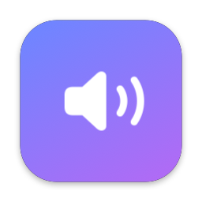
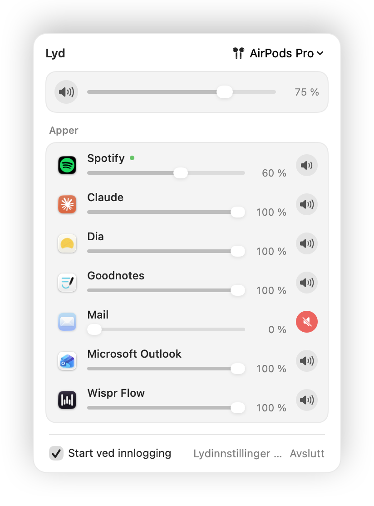
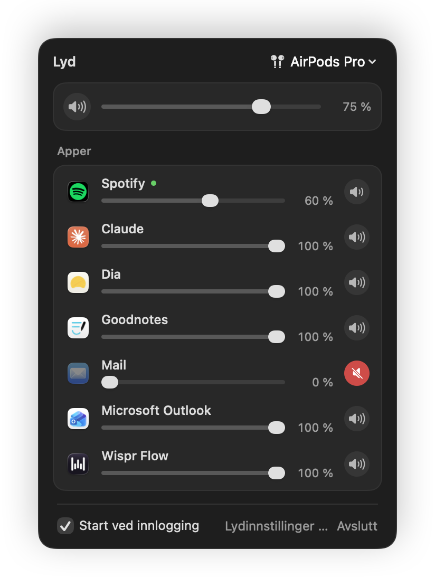

<p align="center">
  
</p>

<h1 align="center">Lydpanel</h1>

<p align="center">
  Volum per app for macOS, rett fra menylinjen.<br>
  Demp Slack, skru ned Spotify og la resten være som før.
</p>

<p align="center">
  
  
  
</p>

<p align="center">
  
  
</p>

---

macOS lar deg bare styre hovedvolumet. Lydpanel er en liten app i menylinjen som gir hver app sin egen glidebryter og dempeknapp, i samme stil som Kontrollsenter. Den trenger ingen ekstra lyddriver og ingen kontoer, og den sender ingenting ut av Macen.

## Funksjoner

- **Volum per app:** hver app som bruker lyd får sin egen glidebryter fra 0 til 100 %.
- **Demp én app:** ett klikk demper en app. Alt annet fortsetter som før.
- **Hovedvolum og demping:** følger med når du bruker volumtastene.
- **Bytt lydutgang:** velg AirPods, høyttalere eller skjerm øverst i panelet.
- **Ser hva som spiller:** en grønn prikk viser hvilke apper som spiller lyd akkurat nå.
- **Husker valgene dine:** er Slack dempet, er den fortsatt dempet neste gang den starter.
- **Start ved innlogging:** ett avkrysningsfelt.
- **Lys og mørk modus:** følger systemet.

## Krav

- macOS 14.2 (Sonoma) eller nyere
- Mac med Apple Silicon (M1 eller nyere)
- Xcode Command Line Tools (gratis, se under)

## Installasjon

Lydpanel bygges fra kildekoden. Det tar under ett minutt.

**1. Installer Command Line Tools** (hopp over dette hvis du allerede har Xcode eller verktøyene):

```bash
xcode-select --install
```

**2. Last ned og bygg:**

```bash
git clone https://github.com/thomas030505/lydpanel.git
cd lydpanel
./build.sh --install
```

Appen blir lagt i `~/Applications/Lydpanel.app` og starter med en gang. Du finner høyttalerikonet øverst til høyre i menylinjen.

**3. Gi tilgang til lyd:** første gang du skrur ned eller demper en app, spør macOS om Lydpanel får tilgang til lyden fra andre apper. Trykk **Tillat**.

> Har du sagt nei ved en feil? Åpne **Systeminnstillinger → Personvern og sikkerhet → Lydopptak** og slå på Lydpanel. Panelet har også en lenke rett dit hvis noe går galt.

## Bruk

| Du vil … | Gjør dette |
| --- | --- |
| Åpne panelet | Klikk på høyttalerikonet i menylinjen |
| Skru ned en app | Dra glidebryteren til appen |
| Dempe en app | Klikk på høyttalerknappen til høyre for appen |
| Sette en app tilbake | Hold musen over raden og klikk **Nullstill** |
| Bytte lydutgang | Klikk på enhetsnavnet øverst til høyre |
| Starte automatisk | Kryss av for **Start ved innlogging** |
| Avslutte | Klikk **Avslutt** nederst i panelet |

Når du avslutter Lydpanel, får alle appene vanlig lyd igjen.

## Slik virker det

Siden macOS 14.2 kan en app fange lyden fra en annen app med Core Audio sine *process taps*. Lydpanel bruker dette slik:

1. Når du skrur ned eller demper en app, lager Lydpanel en tap på appens prosesser og demper originallyden.
2. Lyden går gjennom en privat, usynlig lydenhet. Der ganges den med volumet du har valgt, og så spilles den av på utgangen du bruker.
3. Står en app på 100 % og er ikke dempet, fjernes tappen. Da går lyden helt urørt, uten ekstra forsinkelse.

Lyden behandles bare i minnet og blir aldri tatt opp eller lagret. Apper som spiller gjennom hjelpeprosesser, for eksempel nettlesere, blir samlet under appen de hører til.

```
Sources/
├── LydpanelApp.swift       Menylinje-appen og panelet (SwiftUI)
├── AudioModel.swift        Tilstand: hovedvolum, enheter, apper og innstillinger
├── AppTap.swift            Process tap og lydbehandling for én app
└── CoreAudioHelpers.swift  Små hjelpere rundt Core Audio sitt C-API
```

## Avinstallering

```bash
pkill -x Lydpanel; rm -rf ~/Applications/Lydpanel.app
```

Har du slått på «Start ved innlogging», slår du det av i panelet først.

## Kjente begrensninger

- Volumet går fra 0 til 100 %. Det er ingen forsterkning over 100 %.
- Bare vanlige apper (de med ikon i Dock) vises i listen. Systemlyder styres med hovedvolumet.
- Appen er signert lokalt (ad hoc). Bygger du på nytt, kan macOS spørre om lydtilgang igjen.

## Lisens

[MIT](LICENSE) © 2026 Thomas Schlytter-Henrichsen
